# 📊 EAAS — Employee Attrition Analysis System

<div align="center">


### 🚀 AI-Powered HR Analytics & Employee Attrition Prediction Platform

</div>

---

# 📑 Table of Contents

* [📌 Project Overview](#-project-overview)
* [🎯 Objectives](#-objectives)
* [🧠 Technologies Used](#-technologies-used)
* [🏗️ Project Architecture](#️-project-architecture)
* [📂 Project Structure](#-project-structure)
* [📊 Features](#-features)
* [🤖 Machine Learning Models](#-machine-learning-models)
* [📈 Dashboard Pages](#-dashboard-pages)
* [🔮 Prediction System](#-prediction-system)
* [💡 Business Insights](#-business-insights)
* [🖥️ Streamlit Application](#️-streamlit-application)
* [⚙️ Installation](#️-installation)
* [▶️ Run The Application](#️-run-the-application)
* [📸 Project Screenshots](#-project-screenshots)
* [🔥 Future Enhancements](#-future-enhancements)
* [👨‍💻 Developer](#-developer)
* [📬 Contact](#-contact)
* [⭐ Acknowledgement](#-acknowledgement)

---

# 📌 Project Overview

EAAS (Employee Attrition Analysis System) is an AI-powered HR analytics platform developed to:

* analyze employee attrition trends
* identify workforce risk factors
* predict employee turnover probability
* generate HR business insights
* visualize organizational analytics

The project integrates:

* Machine Learning
* Power BI Dashboards
* Streamlit Web Application
* Data Analytics
* Business Intelligence
* Interactive UI/UX

into a complete end-to-end analytics solution.

---

# 🎯 Objectives

## Primary Goals

✅ Analyze employee attrition trends
✅ Predict employee turnover risks
✅ Generate business intelligence insights
✅ Build interactive dashboards
✅ Develop an AI-powered HR analytics platform
✅ Create a professional analytics web application

---

# 🧠 Technologies Used

| Technology   | Purpose                  |
| ------------ | ------------------------ |
| Python       | Backend Development      |
| Pandas       | Data Cleaning & Analysis |
| NumPy        | Numerical Operations     |
| Scikit-learn | Machine Learning         |
| Power BI     | Dashboard Visualization  |
| Streamlit    | Frontend Web Application |
| Plotly       | Interactive Charts       |
| Matplotlib   | Data Visualization       |
| Seaborn      | Statistical Analysis     |
| CSS          | UI/UX Styling            |

---

# 🏗️ Project Architecture

```text
CSV Dataset
     ↓
Data Cleaning & Preprocessing
     ↓
Exploratory Data Analysis (EDA)
     ↓
Feature Engineering
     ↓
Machine Learning Model Training
     ↓
Power BI Dashboard
     ↓
Streamlit Frontend
     ↓
Prediction System
     ↓
Business Insights
```

---

# 📂 Project Structure

```text
EAAS/
│
├── Data/
│   ├── raw/
│   └── cleaned/
│
├── Models/
│   ├── attrition_model.pkl
│   ├── scaler.pkl
│   └── feature_columns.pkl
│
├── Notebooks/
│   ├── 01_Data_Cleaning.ipynb
|   ├── 02_EDA_Analysis.ipynb
│   └── 03_Model_Training.ipynb
│
├── PowerBI/
│   └── EAAS_Dashboard.pbix
│
├── Reports/
│   └── Screenshots/
│
├── Streamlit_App/
│   ├── app.py
│   ├── pages/
│   ├── assets/
│   └── utils/
│
├── requirements.txt
├── README.md
└── .gitignore
```

---

# 📊 Features

## ✅ HR Analytics Dashboard

* Executive workforce overview
* Attrition analysis
* Salary insights
* Department analysis
* Employee risk analysis

---

## ✅ Prediction System

* AI-powered attrition prediction
* Real-time risk detection
* Probability confidence score
* Employee retention analysis

---

## ✅ Business Insights

* Overtime impact analysis
* Job satisfaction trends
* Salary distribution insights
* Workforce stability analytics

---

## ✅ Premium UI/UX

* Modern purple SaaS theme
* Glassmorphism design
* Smooth animations
* Hover effects
* Interactive tabs
* Multi-page architecture

---

# 🤖 Machine Learning Models

## 1️⃣ Logistic Regression

Used for:

* binary classification
* baseline prediction
* probability estimation

Advantages:

* fast
* interpretable
* lightweight

---

## 2️⃣ Random Forest Classifier

Used for:

* advanced classification
* nonlinear pattern detection
* ensemble learning

Advantages:

* high accuracy
* reduced overfitting
* handles structured HR data effectively

---

# 📈 Dashboard Pages

## 📌 Executive Overview

Displays:

* total employees
* attrition percentage
* average salary
* workforce KPIs

---

## 📌 Attrition Analysis

Displays:

* overtime analysis
* department attrition
* turnover trends
* employee distribution

---

## 📌 Salary & Satisfaction

Displays:

* salary insights
* satisfaction trends
* engagement analysis

---

## 📌 Employee Risk Insights

Displays:

* high-risk employee groups
* retention probability
* workforce stability patterns

---

# 🔮 Prediction System

The prediction module allows users to:

✅ Enter employee details
✅ Predict attrition risk
✅ View prediction confidence
✅ Analyze employee retention probability

Prediction Workflow:

```text
Employee Input
      ↓
Feature Processing
      ↓
ML Model Prediction
      ↓
Probability Calculation
      ↓
Risk Visualization
```

---

# 💡 Business Insights

Key insights discovered from analysis:

* Employees working overtime show higher attrition.
* Lower salary employees leave more frequently.
* Sales department experiences higher turnover.
* Job satisfaction strongly impacts employee retention.
* Long-term employees show lower attrition probability.

---

# 🖥️ Streamlit Application

The frontend includes:

✅ Animated multi-page application
✅ Dashboard integration
✅ Prediction engine
✅ Interactive insights section
✅ Premium custom CSS styling

---

# ⚙️ Installation

## Clone Repository

```bash
git clone https://github.com/yourusername/EAAS-Employee-Attrition-Analysis-System.git
```

---

## Install Requirements

```bash
pip install -r requirements.txt
```

---

# ▶️ Run The Application

```bash
streamlit run app.py
```

---

# 📸 Project Screenshots

---

## 🏠 Main Application

<p align="center">
  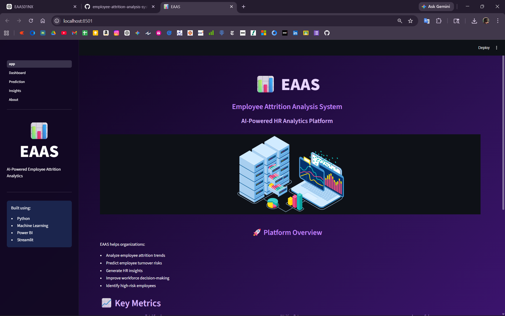
</p>
<p align="center">
  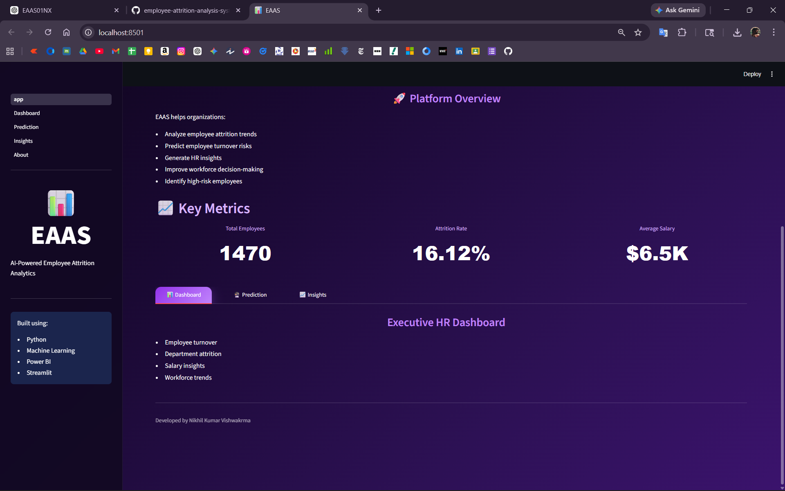
</p>
---

## 📊 Executive Dashboard

<p align="center">
  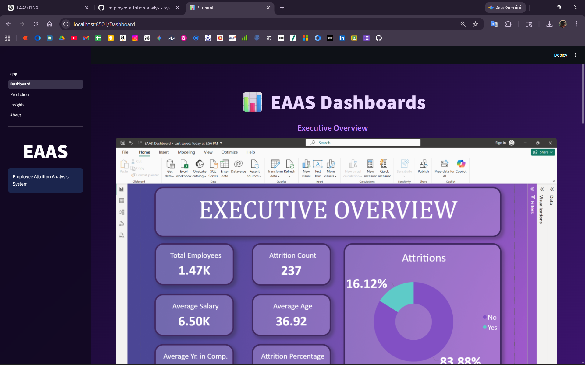
</p>

---

## 🔮 Prediction System

<p align="center">
  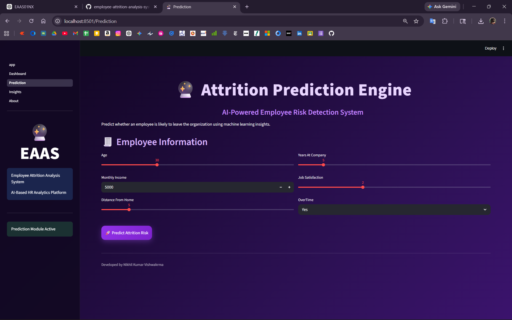
</p>

---

## 📈 Business Insights

<p align="center">
  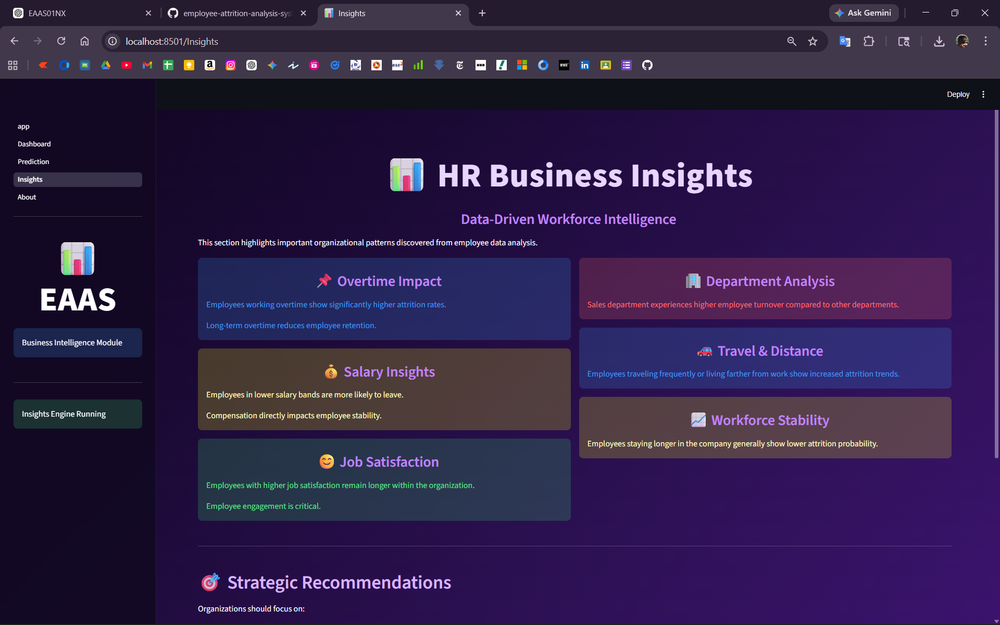
</p>

---

## 📉 Power BI Dashboard

<p align="center">
  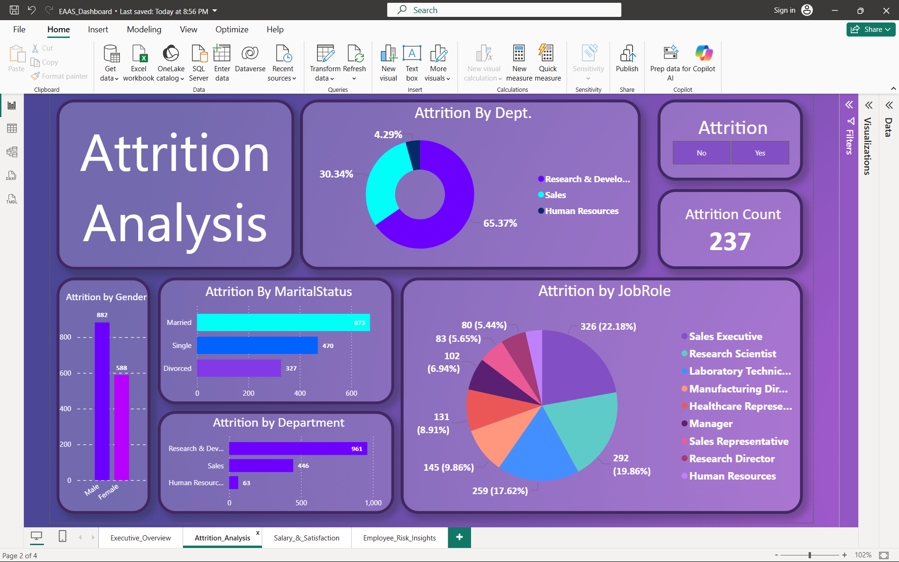
</p>
<p align="center">
  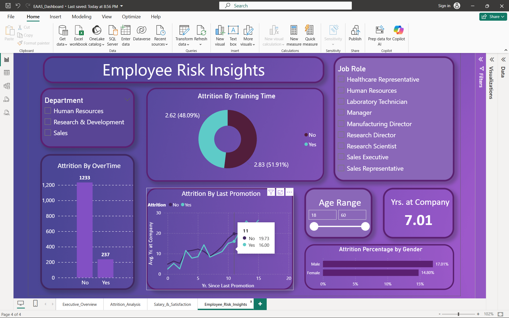
</p>
<p align="center">
  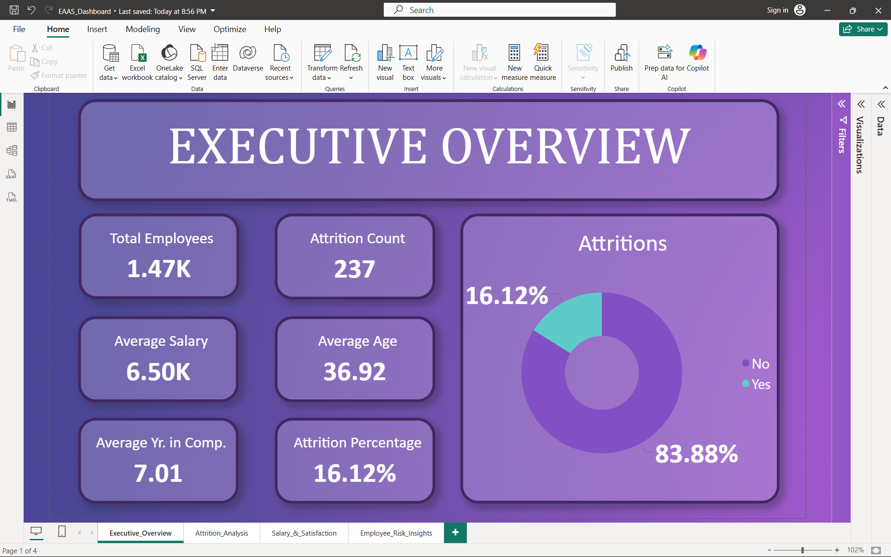
</p>
<p align="center">
  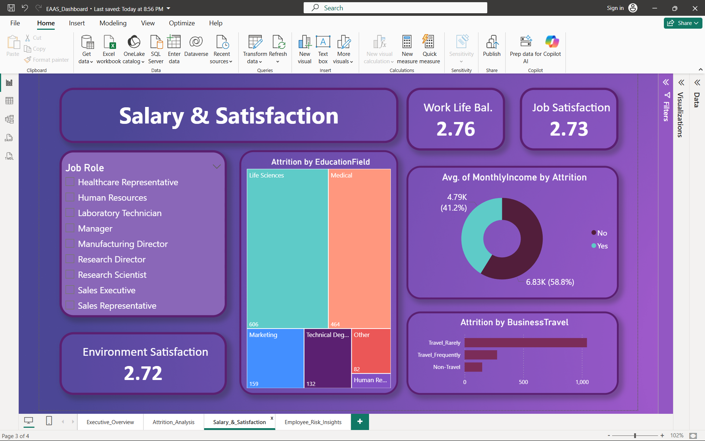
</p>
---

## 🎨 Matplotlib

<p align="center">
  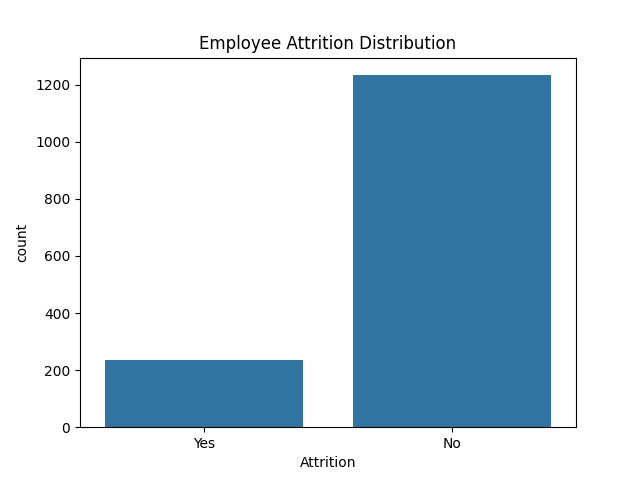
</p>
<p align="center">
  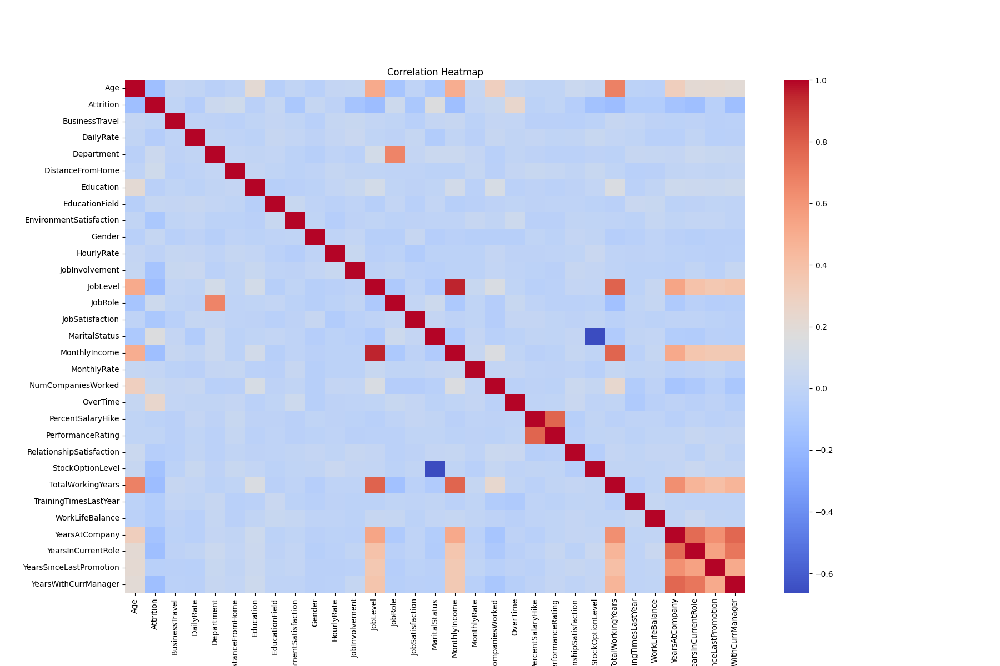
</p>
<p align="center">
  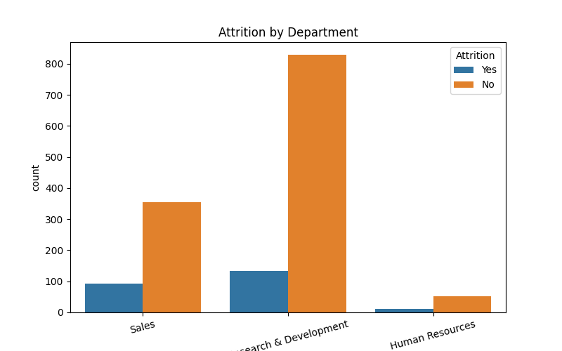
</p>
<p align="center">
  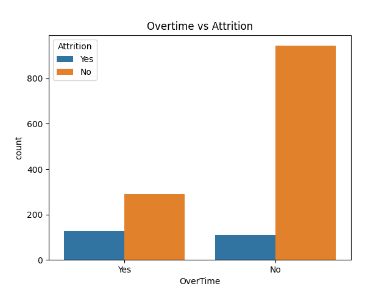
</p>
---

# 🔥 Future Enhancements

## Planned Improvements

* Real-time analytics integration
* Cloud deployment
* Database connectivity
* Authentication system
* AI HR chatbot
* Advanced ML models
* Live Power BI embedding

---

# 👨‍💻 Developer

## Nikhil Kumar Vishwakrma

BCA Student specializing in:

* Data Science
* Artificial Intelligence
* Machine Learning
* Business Intelligence
* Data Analytics

Passionate about building:

* AI-powered systems
* predictive analytics platforms
* dashboard applications
* modern analytics solutions

---

# 📬 Contact

## LinkedIn

www.linkedin.com/in/nikhilvishwakrma2002

---

## Email

nikhilvishwakrma2002@gmail.com

---

# ⭐ Acknowledgement

This project was developed as an end-to-end analytics platform to demonstrate practical implementation of:

* Data Cleaning
* Exploratory Data Analysis
* Machine Learning
* Business Intelligence
* Dashboard Development
* Streamlit Web Applications
* Predictive Analytics
* UI/UX Engineering

---

<div align="center">

# ™️ EAAS

### Employee Attrition Analysis System

Designed & Developed by:

## Nikhil Kumar Vishwakrma

</div>
